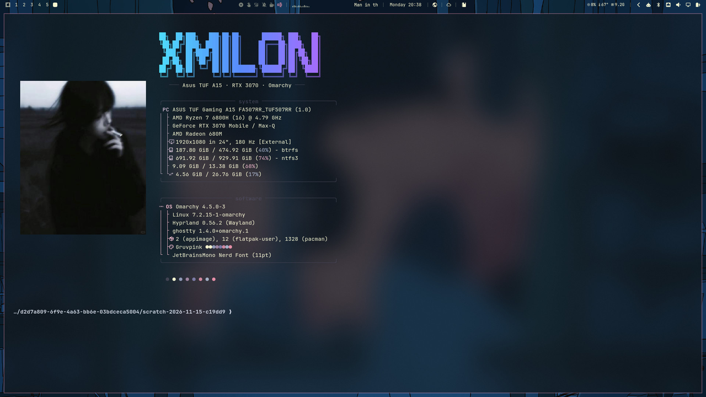

# omarchy-dotfiles

My Omarchy (Arch + Hyprland) setup, ready to put on a new machine.



## Features

### Top bar


From left to right:

- **Workspaces**, on the far left.
- **Indicators**: the small status icons (passwordless sudo, notifications, etc.). They stay visible all the time, and hovering one slides its details open.
- **Music**: sound bars that move with the actual audio, then the song and artist.
- **Clock**, **world clock** and **weather**.
- **Notes / clipboard** icon.
- **System info**: CPU %, CPU temperature and RAM used.
- **Tray and system icons**, on the far right.

Thin dividers separate the groups, and the middle group is centred on the screen.

The bar is **clear** (`"background": "none"` in `shell.json`). Omarchy cycles clear / glassy / opaque when you double-click an empty spot on the bar; `omarchy-bar-lock-patch` turns that off (a pacman hook re-applies it after updates), so it only changes from the menu (Style → Top Bar). Undo: `sudo pacman -S omarchy`.

### Music widget


- **Left-click** the music in the bar to open this popup. **Right-click** plays or pauses, **middle-click** skips, and **scrolling** goes to the previous or next song.
- **Cover art**, title, artist and album at the top.
- **Wave**: follows the music in real time and gets bigger or smaller with the volume. When the music stops it fades out instead of cutting off.
- **Back, play/pause and next** buttons.
- **Timeline** with elapsed/total time. Drag to seek, scroll in 10-second steps, or use the −10s / +10s buttons. The slider also accepts Left/Right when focused.
- **Soft cover-art background**, tinted by the current song and only rendered while the popup is open.
- **Open Spotify** opens the desktop client. **Open player** opens the Omarchy Spotify panel, which now drives your signed-in Spotify desktop app (works on Spotify Free): track, seek, volume, library and search. The native librespot backend needs Premium, so it is switched off. There is no second Spotify widget on the bar.
- **Volume slider** for the player you're listening to. Click the speaker icon to mute; scrolling over the slider works too.
- **Player list** at the bottom: every app playing media (Spotify, a browser…). Click one to control it.
- The widget stays in the bar even when nothing is playing, with flat bars.

### App updates

**Super+Space → Update → Applications** has Discord and T3 Code shortcuts plus **All installed apps…**, a searchable list rebuilt from installed packages and Flatpaks each time it opens. New packages appear automatically. It also offers shell-plugin and uv-tool updates.

Selecting an app opens the normal terminal updater and its confirmation prompt. Arch packages upgrade with system dependencies (`yay -Syu`), avoiding partial upgrades. Flatpaks update independently. AppImages without an update mechanism still need their publisher's download; the menu never executes commands taken from desktop launcher files.

The generated AppImage integration owns Sunrise's launcher entry. The older `net.playsunrise.launcher.desktop` is hidden so Sunrise appears once.

### Popup animations

Every bar popup (clock, weather, audio, network, Bluetooth, power, music, notes, system info, tray menus) pops open with a small overshoot and shrinks away on close. `omarchy-popup-anim-patch` changes Omarchy's two shared popup surfaces (`Ui/KeyboardPanel.qml`, `Ui/PopupCard.qml`); a pacman hook re-applies it after updates and it skips itself if upstream changed. Undo: `sudo pacman -S omarchy`.

### App stores

**Bazaar** (Flathub apps, modern) and **Pamac** (Arch repos + AUR) are both in the app launcher for one-click installs. Pamac has AUR enabled in `/etc/pamac.conf`.

### Menu Back button

`omarchy-menu-back-patch` makes Left/Backspace in the Super+Space menu land on the row you came from, and return from pickers opened by a menu row (e.g. *Update → Applications → All installed apps…*). It edits Omarchy's `Menu.qml`; a pacman hook re-applies it after Omarchy updates, and it skips itself if upstream changed that code. Undo with `sudo pacman -S omarchy`.

### Login screen

[Thyx](https://github.com/rccyx/thyx) is installed for SDDM with a custom clean layout (`system/usr/share/sddm/themes/thyx/src/Main.qml`): blurred current wallpaper, big clock and date, round avatar, name, a single password field, and Sleep / Restart / Shut Down buttons.

- **Follows the wallpaper.** `thyx-background@<user>.path` watches `~/.local/state/omarchy/current` and `~/.config/thyx`; on change, `thyx-sync-background` copies the wallpaper (first frame for videos), the avatar and an accent colour into `/var/lib/thyx-<user>/`, where SDDM can read them before login.
- **Customise** the title in `~/.config/thyx/settings.json` and the avatar by replacing `~/.config/thyx/solo.png`.
- **Autologin is off** (`/etc/sddm.conf.d/zz-thyx-login.conf`) so the screen shows at every boot. The tested Thyx commit is in `packages/thyx-ref.txt`.
- Preview without logging out: `sddm-greeter-qt6 --test-mode --theme /usr/share/sddm/themes/thyx`.
- **External monitor first.** The greeter runs with `/usr/local/share/xmilon/sddm-hyprland.lua` (Omarchy's greeter config plus a rule): when an external monitor is plugged in, the laptop panel is off, so the login screen only shows on the external one. Laptop alone: the panel stays on.
- **One password per boot.** The boot screen's disk-encryption password is the login: Omarchy's SDDM autologin logs straight in after it (`zz-thyx-login.conf` no longer turns autologin off; the Thyx login still shows after logging out). The boot image is a systemd initramfs (`/etc/mkinitcpio.conf.d/zz-xmilon-tpm-unlock.conf`). TPM auto-unlock (`scripts/enable-tpm-unlock.sh`) was tried and removed, since with autologin it would mean no password at all; the script is kept in case the login screen comes back.
- **Faster boot.** The same drop-in leaves nouveau and its ~100 MB of firmware out of the boot image on this hybrid AMD + NVIDIA laptop (the kms hook pulled them in; the proprietary driver is used instead) (this laptop drives every screen from the NVIDIA card). 289 MB → 146 MB, which the firmware reads while the screen is dark.
- **Secure Boot** with our own keys plus Microsoft's (Windows keeps booting): `scripts/enable-secure-boot.sh prepare | enroll | finish`, with the firmware steps in between. `ENABLE_VERIFICATION=no` skips Limine re-hashing the 150 MB kernel image (the firmware already checks its signature), `ENABLE_ENROLL_LIMINE_CONFIG=yes` seals `limine.conf` into the signed loader (otherwise Limine 12 fails open), sbctl's mkinitcpio hook signs every new kernel image, and `xmilon-limine-seal` (pacman hook + `xmilon-limine-seal.path`) re-seals and re-signs Limine after Omarchy's Limine-upgrade hook copies a raw loader over it or anything else edits `limine.conf`. `EFI/BOOT/BOOTX64.EFI` stays stock and unsigned as the rescue loader: if it ever won't boot, turn Secure Boot off and pick "UEFI OS" in the firmware boot menu, then `sudo limine-update`. Snapshots taken before Secure Boot was turned on aren't signed and won't boot while it's on.
- **Boot screen** (Plymouth theme `xmilon`): same blurred wallpaper, avatar, name and glass password pill as the login. When the TPM unlocks the disk it shows the loading bar instead of the pill. Plymouth can't blur or load fonts, so `xmilon-plymouth-render` pre-renders the pieces; it runs as the `xmilon-plymouth` mkinitcpio hook, so a new wallpaper reaches the boot screen at the next boot-image rebuild (`sudo limine-mkinitcpio`, or any kernel update).
- **Screens decided before they light up.** `hypr/monitors.lua` and the greeter config read the kernel's connector status while the config loads, so the laptop screen is never switched on just to be switched off again (a slow black flash on NVIDIA). Output names aren't hard-coded (`eDP-1`/`eDP-2` depends on driver load order).
- **Loading screen after login** (`~/.config/xmilon/session-splash`, started from `hypr/autostart.lua`): same blurred wallpaper and avatar as the login, "Welcome back", and a loading bar that moves as the wallpaper, bar and notifications really come up. Then it fades into the desktop. It gives up after 25 s, and a click skips it. Preview: `XMILON_SPLASH_DEMO=1 qs -n -p ~/.config/xmilon/session-splash`.

### Lock screen

**Super+Ctrl+L** locks (the Win+L equivalent). The lock screen uses the same design as the login screen: blurred wallpaper, clock, round avatar, name, password pill and Sleep / Restart / Shut Down. On both screens the clock slides in from the top and the card from the bottom.

It replaces only the visuals of Omarchy's `plugins/lock/LockView.qml`; password checking is untouched. `omarchy-lock-view-install` only swaps the file when Omarchy's version is the exact one it was written against (checked by hash), so an Omarchy update that changes the lock screen keeps the stock one rather than risking a broken lock. A pacman hook re-applies it after updates. Preview without locking: `omarchy-shell lock preview` (click to close). Undo: `sudo pacman -S omarchy`.

### Screensaver

**Never locks or turns the screen off on idle** (`idle.lock` is `0` in `shell.json`); nothing suspends or logs out, and apps keep running. After 2½ minutes idle the animated screensaver starts:

- The top bar is hidden while it's up.
- After a minute of animation it fades into a still screen: your current wallpaper (videos play, muted) at low brightness, with a large clock, a seconds line and the date. The clock drifts a little every minute so nothing burns in. Only the screensaver's own animation is paused underneath.
- Moving the mouse or pressing a key fades it out and returns to the desktop.
- **Now playing:** while Spotify has a track, a liquid-glass pill above the clock (here and on the lock screen) shows the cover, title, artist, progress and an equalizer. The glass blurs whatever is behind it, live. Clocks use the Outfit font (installed system-wide from `system/usr/local/share/fonts/outfit`, OFL).

`xmilon-screensaver-guard` (started from `hypr/autostart.lua`) drives this; the still screen is a small Quickshell config in `~/.config/xmilon/idle-still` (`XMILON_STILL_AFTER` changes the 60 s delay). It never touches the lock screen.

### Quick Notes


Open it with a left-click on the notes icon or **Super+Alt+N**.

- **Pages** on the left: **+ New page** (Ctrl+N), click one to open it. Pinned pages stay on top.
- **Title** at the top. It shows when the page was created and last edited.
- **Saves as you type**; there is no save button.
- **Paperclip**: attach any file. **Pin**: keep the page on top. **Bin**: move the page to the trash.
- **Images, videos and files** appear in the text where your cursor is. Paste an image with Ctrl+V, drag files in, or use the paperclip.
- **Links** are clickable: **Ctrl+click** a link or an image to open it.
- Pages are plain Markdown files in `~/Notes/Quick/`.

### Notification Center

The bell at the far right of the bar. A number shows how many notifications came in since you last looked.

- **Click** it for the list of the last 24 hours (newest first). Hover a card to **dismiss** it (󰅖) or **mute its app** (󰂛).
- **Right-click** it, or press **On/Silenced** in the panel, for Do Not Disturb.
- **Clear** empties the list. The mute button (󰂠) lists every app that sent something, with a switch each.
- **Muted apps** don't pop up; their notifications still land in the list, marked *muted*. Codes and Omarchy's own prompts always get through. The list is `~/.config/xmilon/notifications-muted.json`.

Muting needs a small patch to Omarchy's notification service (`omarchy-notif-mute-patch`), re-applied after updates by a pacman hook.

### Clipboard


The second tab of the notes panel. Open it with a right-click on the notes icon or **Super+Alt+V**; **Ctrl+1 / Ctrl+2** switch between the two tabs. It uses Omarchy's own clipboard history, so it matches Super+Ctrl+V.

- **Search** at the top: just type.
- Each row shows a thumbnail or icon, then what it is and when it was copied (for example "PNG · Monday 20:32" or "Link · i.pinimg.com").
- **Click** copies the item, and the panel stays open.
- **Right-click** or **Enter** pastes it into the window you were in.
- **Ctrl+click** selects several items (pink, with a ✓) and **Shift+click** selects a range. **Ctrl+C** copies them all, and **Esc** clears the selection. Text is joined into one block; if the selection has images, everything is copied as files.
- **Alt+Enter** opens an item. **Delete** or middle-click removes it. **Shift+Delete** twice clears the whole history.

### System info


Click the CPU / temperature / RAM numbers in the bar.

- **CPU** usage and temperature, with the model and thread count.
- **GPU** usage, temperature and power draw, and **VRAM**. The GPU is only checked while this popup is open, so it isn't woken up for nothing.
- **Memory** and swap, and **disk** space.
- **Uptime** and load.
- **Open btop** / **Open nvtop** open the full system or GPU monitor.

### Wallpapers


**Super+Ctrl+Space** opens the picker. It shows the gruvpink theme's wallpapers plus mine and the black_arch theme's (28 in total). Drop more into `~/.config/omarchy/backgrounds/gruvpink/`.

### Terminal (Ghostty)

The screenshot at the top shows it:

- **Look**: very see-through with blur, and fastfetch with my avatar and the XMILON banner.
- **Copy and paste**: **Ctrl+C / Ctrl+V / Ctrl+X** without Shift (in the shell; nano and vim keep their own keys), and **Ctrl+A** selects the whole command.
- **Editing a selection**: select with Shift+arrows or the mouse, then Backspace or Delete removes it and typing replaces it, like in a text editor. Selecting doesn't copy anything by itself.
- **Plain text**: no syntax colours.

## New machine

Install Omarchy first, then:

```bash
git clone https://github.com/Xmilon/omarchy-dotfiles.git ~/Projects/omarchy-dotfiles
cd ~/Projects/omarchy-dotfiles
./install.sh
```

`./install.sh --configs` copies only the config files and skips packages.
Anything it replaces is backed up to `~/.dotfiles-backup/<date>/` first.

## Saving changes

After changing something on this machine:

```bash
cd ~/Projects/omarchy-dotfiles
./collect.sh
git add -A && git commit -m "Update setup" && git push
```

To track a new file, add its path (relative to your home folder) to `paths.txt`.

Third-party shell plugins are recorded in `packages/plugins.txt` and installed before local overrides. The Spotify override improves native-session failure reporting and contains no credentials. Account sessions, tokens, caches and binaries are not collected.

Focused checks for the media and update-menu changes:

```bash
python tests/test-desktop.py
XDG_RUNTIME_DIR=/run/user/$(id -u) python tests/test-native-session.py
node tests/test-media.cjs
home/.local/bin/omarchy-app-updates --plan pkg:t3code-bin
```

## What's in it (by file)

| Area | What |
|---|---|
| **Bar** (`.config/omarchy/shell.json`, `bar/modules/islands.qml`) | Split into rounded **islands** over a clear bar: `islands.qml` (first in the left section) draws a pill behind each group of widgets, and the `divider` entries are the gaps between islands (`"size"` sets a gap's width). Center: indicators, music, clock, world clock, weather, notes. System info and the system icons on the right. Popups from my widgets pop in with a small bounce; menus and the launcher too (Hyprland `layersIn`, `hypr/looknfeel.lua`). Floating windows get a restyled title bar (Inter, round buttons). |
| **Music widget** (`plugins/xmilon.media`) | Left-click opens the popup, right-click play/pause. cava sound bars in the bar and a wave in the popup. `"vizDelayMs"` on its bar entry shifts the bars to match the sound. |
| **Quick Notes** (`plugins/xmilon.notes`) | Named pages that save as you type, with dates and pinning; images, videos and files inline at the cursor (paste, drop or attach); Ctrl+click opens links. Text in JetBrains Mono, like the rest of the bar. Pages live in `~/Notes/Quick/` (not in this repo). A second **Clipboard** tab is Omarchy's clipboard history with search and thumbnails: click copies (the panel stays open), Ctrl+click or Shift+click selects several and Ctrl+C copies them all (text joined; with images, as files), Enter or right-click pastes, Alt+Enter opens, Delete removes, Shift+Delete twice clears. Super+Alt+N opens notes, Super+Alt+V the clipboard; on the bar icon left-click = notes, right-click = clipboard. |
| **System Info** (`plugins/xmilon.sysinfo`) | CPU %, temperature and RAM in the bar; popup with GPU (nvidia-smi), VRAM, swap, disk, uptime. |
| **Indicators** (`plugins/xmilon.indicators`) | Always visible; only open when hovered themselves, with a slide animation. |
| **Ghostty** | Very translucent with blur, no title bar of its own (floating windows use the shared bar below), no animated shaders (idle ~0% CPU), grey-blue selection that doesn't copy on select; with a mouse selection, Backspace/Delete/Ctrl+X edit the command line; Ctrl+C copies a selection. |
| **Command line** (`.blerc`, ble.sh) | IDE-like completion, no syntax colours, Shift+arrow selection and Ctrl+A select-all with Backspace / Ctrl+C / Ctrl+X / typing-replaces; Ctrl+V pastes (in the shell only, so nano/vim keep theirs). |
| **Files** (`.config/gtk-4.0/gtk.css`) | See-through panels over the blur, rounded hover and selection. |
| **Hyprland** | Super+scroll switches workspaces without the 300 ms delay and slides; Super+middle-click opens a new empty workspace; 1080p@180 external monitor, and the laptop screen turns off while an external monitor is connected (back on when unplugged; `hypr/monitors.lua`); GDK scale 1 (normal-size Steam); digital vibrance at login. |
| **Wallpapers** (`.config/omarchy/backgrounds/gruvpink`) | My wallpapers plus the black_arch and holo-black themes' added to the gruvpink theme, so Super+Ctrl+Space cycles through them along with its own. |
| **Reboot to Windows** (`.local/bin/reboot-to-windows`, `omarchy/extensions/omarchy-menu.jsonc`) | System menu entry that restarts straight into Windows once (asks for your password; uses UEFI BootNext). Windows is also in the Limine boot menu (added with `sudo limine-scan`, not stored in this repo). |
| **Icons** | Conflux, with Papirus-Dark as fallback; a theme hook keeps them after theme changes. |
| **fastfetch** | GitHub avatar, XMILON gradient banner. |
| **SpotX** | Pacman hook that re-applies SpotX after each Spotify update (`system/`). |

Packages are listed in `packages/` (official repos, AUR, Flathub, themes).

## Manual steps

These aren't automated:

- **AppImages** in `~/Applications`: Liner (from github.com/tryliner/desktop), spotifast and Sunrise Launcher.
  Install each with `appimage-integrator install <file>` or right-click → AppImage → Install.
- **Artcraft**: install from its own launcher download (it isn't on Flathub).
- **PeriHub** (mouse/keyboard settings, replaces G HUB etc.): not on the AUR yet. `git clone --branch aur --single-branch https://github.com/hex-dump/perihub.git perihub-aur && cd perihub-aur && makepkg -si`. Quit any vendor app first.
- **Second drive (~/Storage)**: the old 1 TB Windows drive is now encrypted storage at `~/Storage`, unlocked at boot by a key file on the main drive (no extra password). `scripts/setup-storage-drive.sh /dev/<disk>` sets up a drive like that again; it erases it. The key file isn't in this repo.
