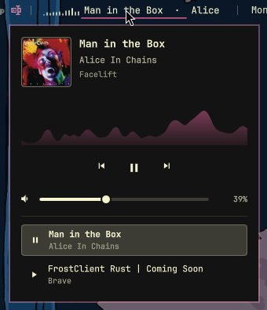
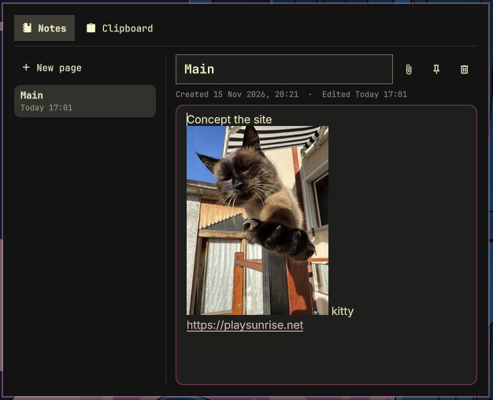
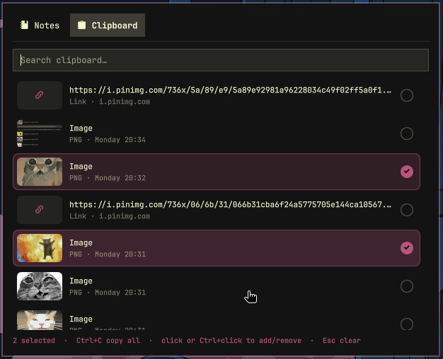
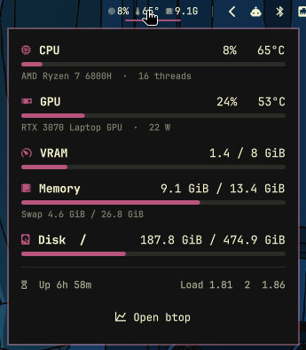
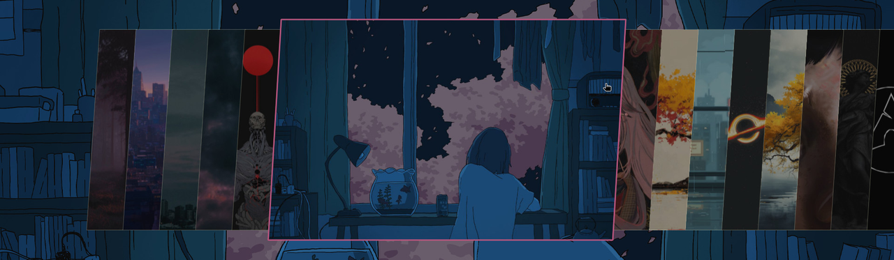

# omarchy-dotfiles

My Omarchy (Arch + Hyprland) setup, ready to put on a new machine.


## Features

### Top bar


From left to right:

- **Workspaces**, on the far left.
- **Indicators**: the small status icons (passwordless sudo, notifications, etc.). They stay visible all the time, and hovering one slides its details open.
- **Music**: sound bars that move with the actual audio, then the song and artist.
- **Clock**, **world clock** and **weather**.
- **Notes / clipboard** icon.
- **System info**: CPU %, CPU temperature and RAM used.
- **Tray and system icons**, on the far right.

Thin dividers separate the groups, and the middle group is centred on the screen.

### Music widget



- **Left-click** the music in the bar to open this popup. **Right-click** plays or pauses, **middle-click** skips, and **scrolling** goes to the previous or next song.
- **Cover art**, title, artist and album at the top.
- **Wave**: follows the music in real time and gets bigger or smaller with the volume. When the music stops it fades out instead of cutting off.
- **Back, play/pause and next** buttons.
- **Volume slider** for the player you're listening to. Click the speaker icon to mute; scrolling over the slider works too.
- **Player list** at the bottom: every app playing media (Spotify, a browser…). Click one to control it.
- The widget stays in the bar even when nothing is playing, with flat bars.

### Quick Notes



Open it with a left-click on the notes icon or **Super+Alt+N**.

- **Pages** on the left: **+ New page** (Ctrl+N), click one to open it. Pinned pages stay on top.
- **Title** at the top. It shows when the page was created and last edited.
- **Saves as you type**; there is no save button.
- **Paperclip**: attach any file. **Pin**: keep the page on top. **Bin**: move the page to the trash.
- **Images, videos and files** appear in the text where your cursor is. Paste an image with Ctrl+V, drag files in, or use the paperclip.
- **Links** are clickable: **Ctrl+click** a link or an image to open it.
- Pages are plain Markdown files in `~/Notes/Quick/`.

### Clipboard



The second tab of the notes panel. Open it with a right-click on the notes icon or **Super+Alt+V**; **Ctrl+1 / Ctrl+2** switch between the two tabs. It uses Omarchy's own clipboard history, so it matches Super+Ctrl+V.

- **Search** at the top: just type.
- Each row shows a thumbnail or icon, then what it is and when it was copied (for example "PNG · Monday 20:32" or "Link · i.pinimg.com").
- **Click** copies the item, and the panel stays open.
- **Right-click** or **Enter** pastes it into the window you were in.
- **Ctrl+click** selects several items (pink, with a ✓) and **Shift+click** selects a range. **Ctrl+C** copies them all, and **Esc** clears the selection. Text is joined into one block; if the selection has images, everything is copied as files.
- **Alt+Enter** opens an item. **Delete** or middle-click removes it. **Shift+Delete** twice clears the whole history.

### System info



Click the CPU / temperature / RAM numbers in the bar.

- **CPU** usage and temperature, with the model and thread count.
- **GPU** usage, temperature and power draw, and **VRAM**. The GPU is only checked while this popup is open, so it isn't woken up for nothing.
- **Memory** and swap, and **disk** space.
- **Uptime** and load.
- **Open btop** opens the full system monitor.

### Wallpapers



**Super+Ctrl+Space** opens the picker. It shows the gruvpink theme's wallpapers plus mine and the black_arch theme's (28 in total). Drop more into `~/.config/omarchy/backgrounds/gruvpink/`.

### Terminal (Ghostty)

The screenshot at the top shows it:

- **Look**: very see-through with blur, and fastfetch with my avatar and the XMILON banner.
- **Copy and paste**: **Ctrl+C / Ctrl+V / Ctrl+X** without Shift (in the shell; nano and vim keep their own keys), and **Ctrl+A** selects the whole command.
- **Editing a selection**: select with Shift+arrows or the mouse, then Backspace or Delete removes it and typing replaces it, like in a text editor. Selecting doesn't copy anything by itself.
- **Plain text**: no syntax colours.

## New machine

Install Omarchy first, then:

```bash
git clone https://github.com/Xmilon/omarchy-dotfiles.git ~/Projects/omarchy-dotfiles
cd ~/Projects/omarchy-dotfiles
./install.sh
```

`./install.sh --configs` copies only the config files and skips packages.
Anything it replaces is backed up to `~/.dotfiles-backup/<date>/` first.

## Saving changes

After changing something on this machine:

```bash
cd ~/Projects/omarchy-dotfiles
./collect.sh
git add -A && git commit -m "Update setup" && git push
```

To track a new file, add its path (relative to your home folder) to `paths.txt`.

## What's in it (by file)

| Area | What |
|---|---|
| **Bar** (`.config/omarchy/shell.json`) | Centered middle group: indicators, music, clock, world clock, weather, notes (with the clipboard tab), with thin dividers. System info on the right. Floating windows get a restyled title bar (Inter, round buttons; `hypr/looknfeel.lua`). |
| **Music widget** (`plugins/xmilon.media`) | Left-click opens the popup, right-click play/pause. cava sound bars in the bar and a wave in the popup. `"vizDelayMs"` on its bar entry shifts the bars to match the sound. |
| **Quick Notes** (`plugins/xmilon.notes`) | Named pages that save as you type, with dates and pinning; images, videos and files inline at the cursor (paste, drop or attach); Ctrl+click opens links. Text in JetBrains Mono, like the rest of the bar. Pages live in `~/Notes/Quick/` (not in this repo). A second **Clipboard** tab is Omarchy's clipboard history with search and thumbnails: click copies (the panel stays open), Ctrl+click or Shift+click selects several and Ctrl+C copies them all (text joined; with images, as files), Enter or right-click pastes, Alt+Enter opens, Delete removes, Shift+Delete twice clears. Super+Alt+N opens notes, Super+Alt+V the clipboard; on the bar icon left-click = notes, right-click = clipboard. |
| **System Info** (`plugins/xmilon.sysinfo`) | CPU %, temperature and RAM in the bar; popup with GPU (nvidia-smi), VRAM, swap, disk, uptime. |
| **Indicators** (`plugins/xmilon.indicators`) | Always visible; only open when hovered themselves, with a slide animation. |
| **Ghostty** | Very translucent with blur, no title bar of its own (floating windows use the shared bar below), no animated shaders (idle ~0% CPU), grey-blue selection that doesn't copy on select; with a mouse selection, Backspace/Delete/Ctrl+X edit the command line; Ctrl+C copies a selection. |
| **Command line** (`.blerc`, ble.sh) | IDE-like completion, no syntax colours, Shift+arrow selection and Ctrl+A select-all with Backspace / Ctrl+C / Ctrl+X / typing-replaces; Ctrl+V pastes (in the shell only, so nano/vim keep theirs). |
| **Files** (`.config/gtk-4.0/gtk.css`) | See-through panels over the blur, rounded hover and selection. |
| **Hyprland** | Super+scroll switches workspaces without the 300 ms delay and slides; Super+middle-click opens a new empty workspace; 1080p@180 external monitor; GDK scale 1 (normal-size Steam); digital vibrance at login. |
| **Wallpapers** (`.config/omarchy/backgrounds/gruvpink`) | My wallpapers plus the black_arch theme's added to the gruvpink theme, so Super+Ctrl+Space cycles through them along with its own. |
| **Reboot to Windows** (`.local/bin/reboot-to-windows`, `omarchy/extensions/omarchy-menu.jsonc`) | System menu entry that restarts straight into Windows once (asks for your password; uses UEFI BootNext). Windows is also in the Limine boot menu (added with `sudo limine-scan`, not stored in this repo). |
| **Icons** | Conflux, with Papirus-Dark as fallback; a theme hook keeps them after theme changes. |
| **fastfetch** | GitHub avatar, XMILON gradient banner. |
| **SpotX** | Pacman hook that re-applies SpotX after each Spotify update (`system/`). |

Packages are listed in `packages/` (official repos, AUR, Flathub, themes).

## Manual steps

These aren't automated:

- **AppImages** in `~/Applications`: Liner (from github.com/tryliner/desktop) and spotifast.
  Install each with `appimage-integrator install <file>` or right-click → AppImage → Install.
- **Artcraft**: install from its own launcher download (it isn't on Flathub).
- **Windows drive / migration data**: not part of this repo.
